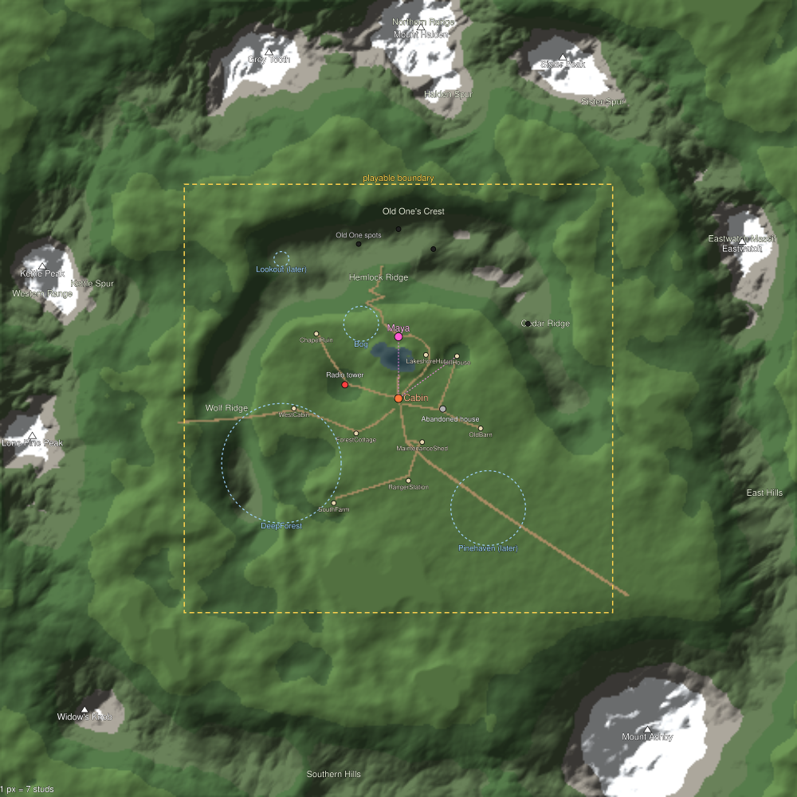

# The world: Pinehaven valley

The game takes place in a Pacific-Northwest valley. The cabin stands in a
forest clearing on the valley floor, with the lake just north of it and
Maya's house on the far shore. Forested ridges rise behind her house and
along both sides of the valley. Snowy ranges stand far out, beyond the
play area. The valley opens to the south-east, toward Pinehaven and a lone
volcano.



North is up. The map shows the whole 3.2 km terrain: the dashed yellow
square is the playable boundary, dashed blue circles are regions, and the
pink dotted lines are the protected views. Regenerate it after any terrain
change (see [Changing the world](#changing-the-world)).
[`world-relief.png`](world-relief.png) is the same shaded relief without
labels. [`world-heightmap.png`](world-heightmap.png) is the raw height:
black is the lake bottom and white is the highest summit.

## Why it was rebuilt

Before November 2026, the terrain rose into a square ring of jagged,
snow-covered walls 780 to 1000 studs from the cabin. The ring stood up to
about 400 studs high, inside the playable boundary, on every side. A
straight ramp also crossed the whole map behind the north ridge. From the
ground the world looked like an arena. The rebuild keeps every gameplay
position and replaces the shape. The Lune specs run the old height
function as a control to prove the difference (see [Tests](#tests)).

## Regions

| Region | Where (x, z) | What it is | Status |
| --- | --- | --- | --- |
| Cabin clearing | (0, 0) | Home. Flat pad at y 5.5 in a forest clearing; the lake shore is 110 studs north | Built |
| The lake | about (0, -158) | Irregular lake with a west cove, a bay below the cabin and an islet; beaches, mud and rocky shores; 12 studs deep | Built |
| Maya's shore | (0, -248) | Maya's house on a terrace above the north beach (pad at y 8) | Built |
| Valley floor | the spine from the bog to the south-east | Livable lowland, height about 3 to 10, gentle rolls; the settlement roads and neighbors | Built |
| Radio Hill | (-215, -55) | Round hill, about 48 high, with the radio tower | Built |
| Hill house hill | (240, -176) | The watched house on its hilltop (pad at about 37) | Built |
| The bog | (-150, -300) | Hollow of mud and dead pines (the threat area) | Built |
| Hemlock Ridge | north, z about -450 | Forested ridge (crest about 80) behind Maya's house, with Hemlock Pass at (-84, -450) | Built |
| Old One's Crest | north, z about -650 | High forested crest (120 to 180), rocky on top; the Old One appears here | Terrain built |
| Wolf Ridge | west, x about -650 | Long ridge (crest about 110) with steep valley side; the west pass at (-690, 82) | Built |
| Cedar Ridge | east, x about 600 | Lower ridge (about 90) with a long gentle east flank | Built |
| Pinehaven | (360, 440), r 150 | Town site on the Valley Road. Kept flat and clear of trees | **Later phase** |
| Deep forest | (-470, 260), r 240 | Denser, darker old growth (cedar and big ponderosa) | Trees built; content **later** |
| Highland lookout | knoll at (-470, -560) | View point over the west, where storms come from | **Later phase** |
| Far ranges | 1.1 to 1.6 km out | Northern Range (Mount Halden behind Maya's house), Western Range, Eastwatch Massif, low hills to the south and east, the volcano Mount Ashby to the south-east | Scenery |

The playable square (±860) ends in low ground behind the ridges. The
invisible boundary walls are unchanged.

## Positions other code depends on

These positions stayed exactly where they were. The terrain is shaped
around them.

| Position | Used by |
| --- | --- |
| Cabin (0, 0), floor y 7 | Shelter volumes, `CreatureService.edgePoint` (all creature bearings), `StoryService`, the menu camera |
| Watcher spawns: bearing -35 to 35, 55 to 120 studs north | `NightDirector`. Now on land up to 100 studs. The old lake swallowed points from 85 studs |
| Opening points: (0, -85), patrol bearings ±66 at 70 and 88, retreat bearing 75 at 240 | `OpeningService`. All on land |
| Crawler and patrol points: any bearing, 50 to 290 studs | `NightDirector`. 100 of 1800 sampled points are in the lake, against 355 before |
| Maya's house (0, -248), y 8; `MayaSpot` parts | `MayaService`, `HouseActivityService` |
| Abandoned house (178, 42), y 6 | `NightDirector` (Dweller at height + 2) |
| `OldOneSpots` | `OldOneService` raycasts from y 400. The ground there is 115 to 140, in view of the cabin window |
| Hill house (235, -170) | The night mystery (`GameConfig.LakeHouse`), observation from the cabin |
| ThreatZone part (y -40 to 80), kill floor (y -60) | Zones. The bog ground is 4 to 40 |

## How the terrain is made

One pure, deterministic function produces the height: `Heightfield.new(WorldConfig).heightAt(x, z)` in
[`src/shared/Logic/Heightfield.luau`](../src/shared/Logic/Heightfield.luau).
It uses only `math.noise`, so the server, the Lune specs and the map
renderer compute exactly the same heights. `WorldConfig.Seed` changes the
noise; the authored shapes stay. The layers, from broad to fine:

1. **Valley floor.** A base height with a slight tilt toward the south-east
   outlet. Near the valley spine (`Terrain.Spine`), the hills stay within a
   few studs; further away they roll up to about 35.
2. **Authored forms** (`WorldConfig.Terrain`):
   - Hills: Gaussian bumps, not warped, because they carry landmarks.
   - Ridges: polylines with a crest height, a half width and an
     asymmetric flank. Saddles are anchored at world points, so a pass
     stays where its trail crosses.
   - Peaks.

   Ridges and peaks are domain-warped by up to 90 studs, so nothing is a
   perfect line or circle. A `rough` factor carves spurs and gullies with
   ridged noise. Crags appear only above 190.
3. **Detail noise** of about 2 studs.
4. **The lake.** Elliptical lobes plus shoreline noise give a signed
   shoreline distance. The ground eases into a beach and a shelf, then
   down to 12 below the water. Islands are land lobes. Outside the lake
   the ground never drops below water, so there are no stray ponds.
5. **Pads.** The cabin, Maya's house and the abandoned house sit on fixed
   pad heights that gameplay code builds on. Neighbor houses take the mean
   ground of their footprint (cut and fill) with a 40-stud blend.
6. **Path beds.** Each trail and road samples the ground along its length
   and averages it over about 50 studs. The bed cuts through bumps and
   fills dips. At junctions the beds blend, and every path is worn in
   0.3 studs.

[`World/Terrain.luau`](../src/server/World/Terrain.luau) writes the voxels
at server start:

- **Height grid.** It evaluates the height once per 4-stud column into a
  grid of 640,000 columns. Slopes come from the neighbouring columns.
- **Materials.** Snow lies above about 240 (±25) and rock covers slopes
  steeper than 1.1. Bare ground and rock cover the alpine zone (above
  175). The shore is sand, pebbles or mud by stretch. Paths are ground,
  the bog is mud and the meadows and cabin yard are grass. Elsewhere the
  forest floor mixes leafy grass, grass and ground.
- **Chunks.** It writes 64-stud chunks, each only over its own height
  band. Chunks outside the play area get a thin band and no rock floor.
  This comes to about 8.4 million voxels, against 22 to 27 million if
  every band started below the water line.
- **Yielding.** It yields on a 0.1 s work budget, not after every chunk.

Extent: `HalfSize` 1600 (terrain from -1600 to 1600). `PlayableRadius` 860
is unchanged.

## Paths

- **Lakeside path.** From the cabin around the east shore, past the
  lakeshore hut, to Maya's porch: 352 studs, about 25 seconds at walking
  speed. The objective text has always said "Follow the path around the
  lake"; until now no path existed.
- **Down to the beach** below the cabin.
- **Settlement trails** (unchanged routes).
- **Highland trail.** From Maya's house past the bog, with switchbacks over
  Hemlock Pass, to the foot of the Old One's Crest.
- **West pass trail.** From the west cabin over Wolf Ridge's saddle.
- **Valley Road.** A 12-wide gravel road from the settlement past the
  Pinehaven site and out of the valley to the south-east.

Planned for the highland phase (not built): a switchback trail up the Old
One's Crest from the foot of the highland trail, and a branch to the
lookout knoll. Both need a pass or switchbacks to stay under a 0.5 grade.

## Sightlines

`WorldConfig.Sightlines` lists view corridors that stay free of trees:

- **Cabin to Maya's house.** From the north window, 12 studs wide at the
  cabin and 34 at her house.
- **Cabin to the hill house.**

The specs also check that the terrain itself never blocks these views or
the view of the Old One spots.

## Forest

[`World/Forest.luau`](../src/server/World/Forest.luau) works from a seeded
34-stud cell grid.

- **Groves.** Each cell grows 0 to 1.6 trees by local density. Two noise
  scales make groves and glades. The deep forest and the hills are
  thicker, meadows and the shore thinner, and the cabin keeps its
  clearing. Trunks stand at least 6 studs apart.
- **Species by biome.** Cedar, birch and oak grow by the water. Cedar and
  big ponderosa fill the deep forest. Frosted pines grow only near the
  treeline (above 135); no trees grow above 150.
- **Exclusions.** No trees on building pads, trails and roads, the lake
  and its beach, reserved regions, cliffs or the sightlines.
- **Understory.** Bushes grow at grove edges and fern patches in dense
  stands, with mushrooms and fallen logs. Rocks favour slopes and rocky
  shores. Old stumps stand around the cabin and the settlement.
- **Scenery fringe.** Outside the play area, 420 trees cover the slopes.
  They have no collider, no shadows and are never resources.
- **Resources.** Gatherable trees, rocks, bushes and mushrooms follow the
  same rules as before, including the guaranteed wood near the cabin. The
  one guaranteed tree that stood in the cabin-to-Maya view is skipped.

## Atmosphere

`WorldConfig.Atmosphere` sits on top of the time-of-day keyframes in
`GameConfig.Time.Lighting`. It adds haze and a little density, raises the
atmosphere offset so distant ridges blend toward the sky, cools the haze
colour and softens the glare. The lake water is muted green-grey and
reflects less (`Terrain.generate`).

## Tests

[`tests/terrain.spec.luau`](../tests/terrain.spec.luau) runs in
`./scripts/check.sh`. It checks:

- **Determinism.** The same seed gives the same heights; another seed
  gives different ones.
- **Pads.** The fixed pads are flat at the gameplay heights and close to
  the ground around them.
- **Water.** The lake is deep, water appears only in the lake, and the
  shoreline is not a circle. Every building, landmark, meadow and Maya's
  porch is on dry land, off the shore.
- **Valley shape.**
  - The horizon from the cabin varies, stays under 21° and opens to the
    south.
  - From the cabin, the shore, Radio Hill, the hill house and the Valley
    Road, terrain always rises above eye level, so the end of the
    terrain is never visible.
  - No snow lies inside the playable square, and snowy ground is always
    more than 1000 studs from the cabin.
  - Nothing at the playable boundary rises like a wall.
- **Creatures.** Watcher and opening points are on land. No more random
  spawn points fall in the lake than before. The ground stays under the
  `edgePoint` and Old One raycast origins.
- **Views.** The cabin window sees Maya's two windows, the hill house and
  every Old One spot.
- **Paths.** The path to Maya is dry, under 0.35 grade and 250 to 450
  long. Every trail and road is dry and under 0.5 grade.

The control checks run the pre-rebuild function from
[`tests/fixtures/legacy_terrain.luau`](../tests/fixtures/legacy_terrain.luau).
It fails the shape checks: it enclosed every bearing, had walls inside the
play area and ramped up at the whole boundary.

## Changing the world

1. Edit `src/shared/Config/WorldConfig.luau` (forms, lake lobes, paths,
   regions, sightlines).
2. Run `./scripts/check.sh`. The specs say which gameplay position the
   change broke.
3. Regenerate the maps:

   ```bash
   lune run tools/terrain/render_map docs 480
   ```

   A third argument renders a window around the cabin, for example
   `lune run tools/terrain/render_map /tmp/map 500 900` for the play area.
4. Check it in Studio at ground level. Terrain exists only after the
   server starts, not in Edit mode.

## Known limits

- The playable boundary is still a square of invisible walls. It now
  stands in low ground behind the ridges, so you can walk into it.
- Some random creature points (`NightDirector` crawlers and patrols, and
  Watchers rolled at 100 to 120 studs) still land in the lake, as before
  the rebuild but fewer. Creatures placed there stand on the water
  surface.
- The lake has no outlet creek.
- From the high crest (eye at about 150), the lowest southern far hills
  sit below eye level, so the terrain edge may show through the haze
  there. The specs check the lowland viewpoints only.
